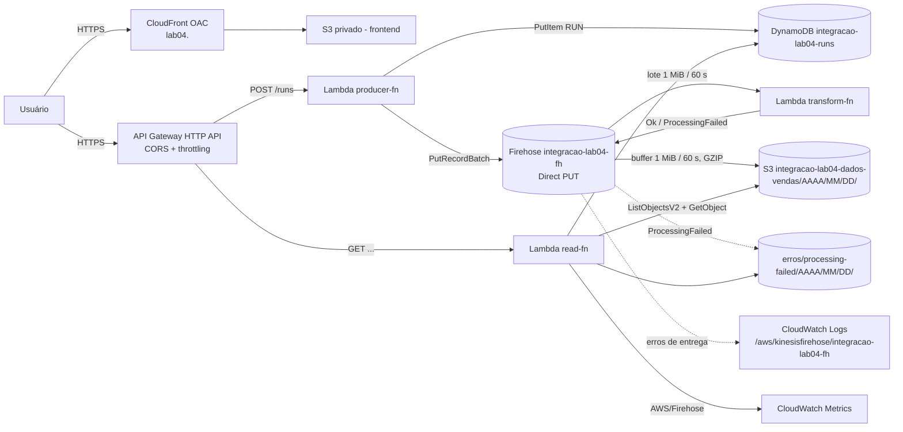

# Entrega de Vendas no S3 com Amazon Data Firehose: Buffer, Transformação Lambda e Tratamento de Erros

**Documento:** Arquitetura

## 1. Visão geral

Uma Lambda produtora envia vendas ao Firehose (ingestão direta). O Firehose acumula no buffer, invoca a transformadora, comprime em GZIP e grava no S3 com prefixo por data. Registros `ProcessingFailed` vão para o prefixo de erro. A Lambda de leitura conta os registros de cada envio dentro dos arquivos.


*Figura 1 — Arquitetura técnica da infraestrutura AWS, de ponta a ponta.*

O mesmo fluxo, em formato de diagrama de texto:



## 2. Acesso ao dashboard

| Camada | Decide | Resultado |
|---|---|---|
| API Gateway | Origem (CORS) e limite de requisições | Bloqueio CORS; **429** acima do limite |
| `producer-fn` | Quantidade entre 10 e 500 e percentual de inválidos entre 0 e 50 | **400** fora da faixa |

Não há chave nem login: a API é aberta, e o throttling e a faixa validada são os únicos limites.

## 3. Componentes e justificativas

| Componente | Nome | Função | Por quê |
|---|---|---|---|
| Firehose | `integracao-lab04-fh` | Buffer, transformação, compressão e entrega | Foco do lab. |
| Lambda produtora | `integracao-lab04-producer-fn` | `POST /runs` → `PutRecordBatch` | Produtor próprio do lab; quantidade exata de inválidos. |
| Lambda transformadora | `integracao-lab04-transform-fn` | Contrato de transformação do Firehose | Enriquecimento e `ProcessingFailed`. |
| Lambda de leitura | `integracao-lab04-read-fn` | 4 rotas `GET` | Conta o que chegou de fato ao S3. |
| S3 de dados | `integracao-lab04-dados-<ACCOUNT_ID>` | `vendas/` e `erros/` | Data lake do lab. |
| DynamoDB | `integracao-lab04-runs` | Registro de cada envio | Aceitos e esperado por envio. |
| Role do Firehose | `KinesisFirehoseServiceRole-...` | Gravar no S3, invocar a transformadora, registrar erros | Criada pelo Console; equivalente a `iam/policy-firehose-role.json`. |
| API, S3, CloudFront, ACM, Route 53 | `integracao-lab04-api`, `integracao-lab04-dashboard-<ACCOUNT_ID>` | Dashboard | Privado com OAC e domínio próprio. |

## 4. Fluxo de dados

1. `POST /runs` chega à `producer-fn`: quantidade de 10 a 500 e percentual de inválidos de 0 a 50.
2. A produtora gera as vendas (uma quantidade **exata** com `amount` = `"INVALIDO"`) e envia em lotes de até 500.
3. A produtora grava o `RUN` com `accepted`, `invalidosGerados` e `esperadoEntregues`.
4. O Firehose acumula e chama a transformadora com o lote.
5. Para cada registro, a transformadora devolve `Ok` (com o JSON enriquecido + quebra de linha) ou `ProcessingFailed`.
6. Quando o buffer de entrega atinge 1 MiB **ou** 60 s, o Firehose grava um arquivo GZIP em `vendas/` e, se houver falhas, outro em `erros/processing-failed/`.
7. A `read-fn` lista os arquivos gravados a partir do horário do envio, abre cada um (GZIP ou texto) e conta as linhas daquele `correlationId`.


*Figura 2 — Visão informativa da arquitetura: dashboard, API, ingestão no Firehose, transformação, S3 e observabilidade.*

## 5. Contrato da transformação

**Entrada (enviada pelo Firehose):**

```json
{"invocationId": "...", "deliveryStreamArn": "...", "region": "us-east-1",
 "records": [{"recordId": "49546...", "approximateArrivalTimestamp": 1762200000000, "data": "<base64>"}]}
```

**Saída (devolvida pela Lambda), um item por registro recebido:**

```json
{"records": [{"recordId": "49546...", "result": "Ok", "data": "<base64 do JSON enriquecido>"},
             {"recordId": "49547...", "result": "ProcessingFailed"}]}
```

| Regra | Resultado |
|---|---|
| `amount` numérico, finito e > 0 | `Ok` + `currency`, `enriched`, `year`, `month`, `day` |
| `amount` texto, zero, negativo, `nan`, `inf` ou ausente | `ProcessingFailed` |
| Exceção na função inteira | O Firehose repete e, se persistir, grava o lote em `erros/` com `Lambda.FunctionError` |

## 6. Prefixos e formato no S3

| Configuração | Valor | Resultado |
|---|---|---|
| Prefixo | `vendas/!{timestamp:yyyy/MM/dd}/` | `vendas/2026/11/03/integracao-lab04-fh-1-2026-11-03-20-01-03-<id>.gz` |
| Prefixo de erro | `erros/!{firehose:error-output-type}/!{timestamp:yyyy/MM/dd}/` | `erros/processing-failed/2026/11/03/...gz` |
| Fuso | UTC | Envio às 22h de Brasília cai no dia seguinte |
| Compressão | GZIP | Arquivos `.gz` |

A data do prefixo é a do registro **mais antigo** do arquivo (horário aproximado de chegada). Quando o prefixo usa expressões, o prefixo de erro é **obrigatório** e precisa de `!{firehose:error-output-type}`.

Linha de um arquivo de erro:

```json
{"attemptsMade":1,"arrivalTimestamp":1762200000000,"errorCode":"Lambda.ProcessingFailed","errorMessage":"...","attemptEndingTimestamp":1762200001000,"rawData":"<base64 do original>","lambdaArn":"arn:aws:lambda:...:function:integracao-lab04-transform-fn:$LATEST"}
```


*Figura 3 — Pasta vendas/ no bucket de dados do Firehose, organizada por data.*

## 7. Buffer: tamanho ou tempo

| Buffer | Configuração | Função |
|---|---|---|
| Da transformação | 1 MiB / 60 s | Quanto o Firehose junta antes de chamar a Lambda |
| Da entrega | 1 MiB / 60 s | Quanto junta antes de gravar o arquivo |

Vale o que vier primeiro. No lab (até ~100 KB por envio) o tempo sempre vence, então o atraso fica perto de 1 minuto. Num sistema com muito volume, o tamanho vence e os arquivos saem mais rápido e maiores.

## 8. Observabilidade (fidelidade)

| Indicador | Fonte |
|---|---|
| Aceitos | Resposta do `PutRecordBatch` (`FailedPutCount`) |
| Entregues / com erro por envio | Contagem de linhas nos arquivos do S3 |
| Atraso até o 1º arquivo | `LastModified` do primeiro arquivo − `createdAt` do envio |
| `IncomingRecords`, `DeliveryToS3.Records`, `DeliveryToS3.DataFreshness` | CloudWatch `AWS/Firehose`, últimos 60 min |
| Erros de entrega | CloudWatch Logs `/aws/kinesisfirehose/integracao-lab04-fh` |

Sem dado, o indicador é `null` e o dashboard mostra "—".

## 9. Segurança

- Dois buckets privados (dados e dashboard); o do dashboard só é lido pelo CloudFront (OAC).
- CSP restritiva e DOM sem `innerHTML`.
- API aberta (sem chave nem login), limitada por throttling e por validação de faixa; sem segredos no `config.js`.
- IAM mínimo: a produtora só envia a este fluxo; a transformadora não acessa nada; a leitura só lê o bucket de dados e a tabela; a role do Firehose só grava neste bucket e invoca esta função.
- Dados sintéticos, sem PII.


*Figura 4 — Configuração de CORS da API, restrita ao endereço do dashboard.*

## 10. Firehose × Kinesis Data Streams

| Aspecto | Data Firehose (este lab) | Kinesis Data Streams (LAB-03) |
|---|---|---|
| Papel | Entregar a um destino (S3, Redshift, OpenSearch...) | Transportar para consumidores próprios |
| Consumidores | O próprio serviço | Vários, cada um com sua posição |
| Releitura | Não | Sim, dentro da retenção |
| Latência | Buffer (dezenas de segundos) | Subsegundo |
| Capacidade | Automática | Shards (ou sob demanda) |
| Combinação comum | Firehose lendo de um Kinesis Data Stream | — |

O lab usa **ingestão direta** para não repetir o LAB-03 e não pagar shard-hora. Se quiser testar a origem Kinesis, crie um stream temporário **dentro deste lab**, nunca o do LAB-03.

## 11. Decisões de arquitetura

- **Sem autenticação** em vez de Cognito ou chave: o foco é o Firehose; o throttling limita o uso.
- **Quantidade exata de inválidos** para o resultado ser conferível (ex.: 90 + 10).
- **Contagem nos arquivos** em vez de contar objetos: prova o que foi entregue por envio.
- **JSON + GZIP**: sem dependência do Glue.
- **Log de erros do Firehose ativado**: única forma de ver falha de gravação no S3.

## 12. Limitações conhecidas

- A leitura abre no máximo 40 arquivos novos por consulta.
- A busca por linhas usa o texto `"correlationId": "<id>"` (formato gerado pela transformadora).
- Parquet e origem Kinesis apenas documentados.